<picture>
  <source media="(prefers-color-scheme: dark)" srcset="./assets/header-dark.svg">
  <source media="(prefers-color-scheme: light)" srcset="./assets/header-light.svg">
  
</picture>

<picture>
  <source media="(prefers-color-scheme: dark)" srcset="./assets/card-dark.svg">
  <source media="(prefers-color-scheme: light)" srcset="./assets/card-light.svg">
  
</picture>

### 🛠️ Teknolojiler

<!-- skills:start (profile.json > skills listesiyle birleştirilir; buraya elle eklediklerin silinmez) -->
<picture>
  <source media="(prefers-color-scheme: dark)" srcset="https://skillicons.dev/icons?i=git%2Cdocker%2Clinux%2Cwindows%2Cpostgres%2Cmysql%2Chtml%2Ccss%2Csqlite%2Cvscode&perline=14&theme=dark">
  <source media="(prefers-color-scheme: light)" srcset="https://skillicons.dev/icons?i=git%2Cdocker%2Clinux%2Cwindows%2Cpostgres%2Cmysql%2Chtml%2Ccss%2Csqlite%2Cvscode&perline=14&theme=light">
  
</picture>
<!-- skills:end -->

<picture>
  <source media="(prefers-color-scheme: dark)" srcset="./assets/divider-dark.svg">
  <source media="(prefers-color-scheme: light)" srcset="./assets/divider-light.svg">
  
</picture>

<!-- languages:start (profile.json > languages listesiyle birleştirilir; buraya elle eklediklerin silinmez) -->
<picture>
  <source media="(prefers-color-scheme: dark)" srcset="https://skillicons.dev/icons?i=c%2Ccpp%2Cpython%2Cjava%2Cjs&perline=14&theme=dark">
  <source media="(prefers-color-scheme: light)" srcset="https://skillicons.dev/icons?i=c%2Ccpp%2Cpython%2Cjava%2Cjs&perline=14&theme=light">
  
</picture>
<!-- languages:end -->

### 📊 Canlı İstatistikler

<picture>
  <source media="(prefers-color-scheme: dark)" srcset="./assets/stats-dark.svg">
  <source media="(prefers-color-scheme: light)" srcset="./assets/stats-light.svg">
  
</picture>

<picture>
  <source media="(prefers-color-scheme: dark)" srcset="./assets/activity-dark.svg">
  <source media="(prefers-color-scheme: light)" srcset="./assets/activity-light.svg">
  
</picture>

<!--
  profile.json dosyasını düzenle, sonra animasyonlu SVG'leri yeniden üret:
    python scripts/generate.py
-->
