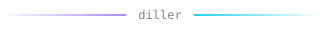

<picture>
  <source media="(prefers-color-scheme: dark)" srcset="./assets/header-en-dark.svg">
  <source media="(prefers-color-scheme: light)" srcset="./assets/header-en-light.svg">
  
</picture>

<picture>
  <source media="(prefers-color-scheme: dark)" srcset="./assets/card-en-dark.svg">
  <source media="(prefers-color-scheme: light)" srcset="./assets/card-en-light.svg">
  
</picture>

### 🛠️ Tech Stack

<!-- skills:start (merged with profile.json > skills; icons you add here by hand are kept) -->
<picture>
  <source media="(prefers-color-scheme: dark)" srcset="https://skillicons.dev/icons?i=git%2Cdocker%2Clinux%2Cwindows%2Cpostgres%2Cmysql%2Chtml%2Ccss%2Csqlite%2Cvscode&perline=14&theme=dark">
  <source media="(prefers-color-scheme: light)" srcset="https://skillicons.dev/icons?i=git%2Cdocker%2Clinux%2Cwindows%2Cpostgres%2Cmysql%2Chtml%2Ccss%2Csqlite%2Cvscode&perline=14&theme=light">
  
</picture>
<!-- skills:end -->

<picture>
  <source media="(prefers-color-scheme: dark)" srcset="./assets/divider-dark.svg">
  <source media="(prefers-color-scheme: light)" srcset="./assets/divider-light.svg">
  
</picture>

<!-- languages:start (merged with profile.json > languages; icons you add here by hand are kept) -->
<picture>
  <source media="(prefers-color-scheme: dark)" srcset="https://skillicons.dev/icons?i=c%2Ccpp%2Cpython%2Cjava%2Cjs&perline=14&theme=dark">
  <source media="(prefers-color-scheme: light)" srcset="https://skillicons.dev/icons?i=c%2Ccpp%2Cpython%2Cjava%2Cjs&perline=14&theme=light">
  
</picture>
<!-- languages:end -->

### 📊 Live Stats

<picture>
  <source media="(prefers-color-scheme: dark)" srcset="./assets/stats-en-dark.svg">
  <source media="(prefers-color-scheme: light)" srcset="./assets/stats-en-light.svg">
  
</picture>

<picture>
  <source media="(prefers-color-scheme: dark)" srcset="./assets/activity-en-dark.svg">
  <source media="(prefers-color-scheme: light)" srcset="./assets/activity-en-light.svg">
  
</picture>

<b>🇹🇷 Türkçe</b>

 

<picture>
  <source media="(prefers-color-scheme: dark)" srcset="./assets/header-tr-dark.svg">
  <source media="(prefers-color-scheme: light)" srcset="./assets/header-tr-light.svg">
  
</picture>

<picture>
  <source media="(prefers-color-scheme: dark)" srcset="./assets/card-tr-dark.svg">
  <source media="(prefers-color-scheme: light)" srcset="./assets/card-tr-light.svg">
  
</picture>

### 📊 Canlı İstatistikler

<picture>
  <source media="(prefers-color-scheme: dark)" srcset="./assets/stats-tr-dark.svg">
  <source media="(prefers-color-scheme: light)" srcset="./assets/stats-tr-light.svg">
  
</picture>

<picture>
  <source media="(prefers-color-scheme: dark)" srcset="./assets/activity-tr-dark.svg">
  <source media="(prefers-color-scheme: light)" srcset="./assets/activity-tr-light.svg">
  
</picture>

<!--
  EN: edit profile.json (Turkish texts at the top level, English texts under "en"), then regenerate:
  TR: profile.json dosyasını düzenle (Türkçe metinler en üstte, İngilizceler "en" altında), sonra yeniden üret:
    python scripts/generate.py
-->
